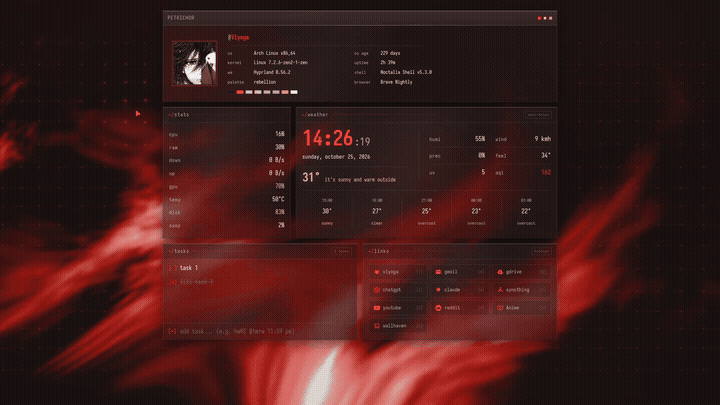
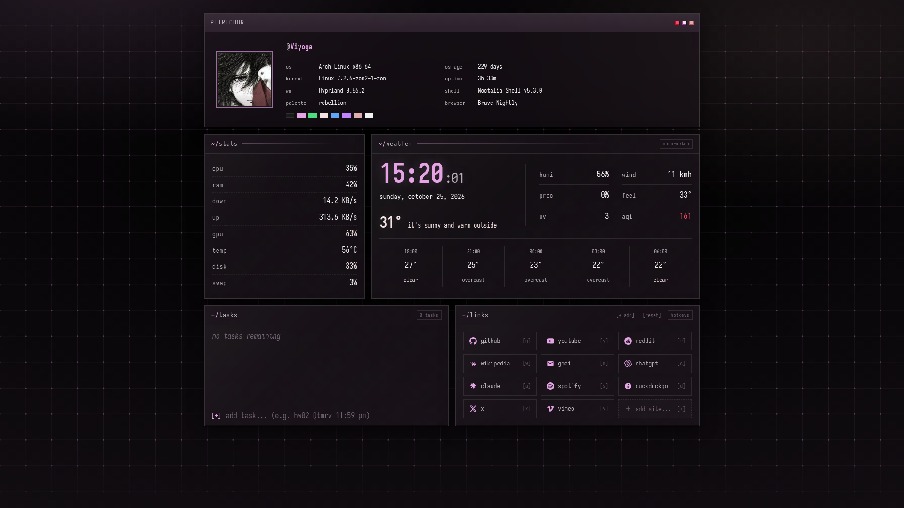
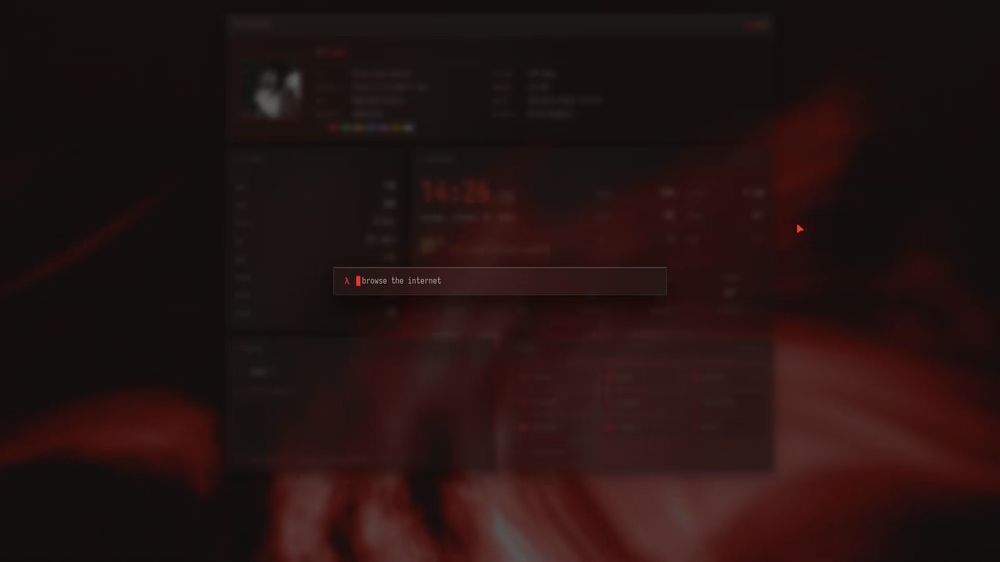

<div align="center">

# 🌧️ Petrichor

**An ultra-aesthetic, glassmorphic startpage & browser extension featuring Neovim-style command search, live system specs, real-time weather, interactive tasks, and instant hotkeys.**

[](LICENSE)
[](newtab.html)

---

[-orange.svg)](assets/showcase.mp4)

<p align="center">
  
</p>

</div>

---

## 📸 Screenshots

| Clean Dashboard | Neovim Command Palette Search |
| :---: | :---: |
|  |  |

---

## ✨ Features

- **Terminal System Card (Fastfetch)**: Displays current OS, kernel, desktop environment / WM, uptime, shell, browser, and palette badges beside a profile avatar.
- **Glassmorphic Aesthetic**: Deep dark gradients, reactive cursor light flares, and dynamic background particle web.
- **24-Hour Clock & Natural Weather**: Precise clock with seconds, date display, and real-time Open-Meteo weather with humanized condition phrases (*"it's sunny and warm outside"*).
- **Interactive Task List**: Add tasks with due tags (`hw02 @tmrw 11:59 pm`), toggle completion, navigate with keys, and persist everything in local storage.
- **Customizable Shortcuts Grid**: Quick access to favorite sites with dedicated hotkey badges. Add your own sites, delete existing ones with the hover remove button, customize hotkeys, or manage them from the search command palette (`!add`, `!del`, `!reset-links`). Saved locally in your browser.
- **Neovim-Style Command Palette Search**:
  - Press <kbd>Space</kbd> or <kbd>/</kbd> to open.
  - Solid square block cursor in Neovim normal mode style with faded placeholder.
  - Search history & visited site memory with instant fuzzy suggestions.
  - Full keyboard navigation with <kbd>Ctrl</kbd> + <kbd>J</kbd> (down) and <kbd>Ctrl</kbd> + <kbd>K</kbd> (up) or arrow keys.
  - Bang shortcuts (`/yt` for YouTube, `/rr` for Reddit, `/gg` for Google, `/dd` for DuckDuckGo, `/ss` for Startpage).

---

## 🚀 Easy Installation

### 1. Chromium Browsers (Brave, Chrome, Edge, Helium, Opera)

1. Clone or download this repository:
   ```bash
   git clone https://github.com/viyoga/petrichor.git
   ```
2. Open your browser and navigate to:
   - **Brave**: `brave://extensions`
   - **Chrome**: `chrome://extensions`
   - **Edge**: `edge://extensions`
3. Toggle on **Developer mode** (top-right corner).
4. Click **Load unpacked** (top-left) and select the `petrichor` folder.
5. Open a new tab and enjoy!

---

### 2. Firefox & LibreWolf & Zen Browser

1. Download the pre-built `petrichor.xpi` from this repo, or build it yourself:
   ```bash
   sh package.sh
   ```
2. Navigate to `about:debugging#/runtime/this-firefox` (or `about:addons`).
3. Click **Load Temporary Add-on...** and select `petrichor.xpi` (or `manifest.json`).

---

### 3. Standalone Web Startpage (No Extension Needed)

You can also use Petrichor as a standalone local startpage in any browser:
- Double click `newtab.html` to open it as a `file://` URL.
- Or host it locally:
  ```bash
  python3 -m http.server 8080 --directory /path/to/petrichor
  ```
  Then set your browser's homepage / new tab URL to `http://localhost:8080/newtab.html`.

---

## ⌨️ Keybindings

| Key | Action |
| --- | --- |
| <kbd>Space</kbd> or <kbd>/</kbd> | Open Command Palette search |
| <kbd>Ctrl</kbd> + <kbd>J</kbd> or <kbd>↓</kbd> | Move down through search suggestions |
| <kbd>Ctrl</kbd> + <kbd>K</kbd> or <kbd>↑</kbd> | Move up through search suggestions |
| <kbd>Enter</kbd> | Execute selected suggestion / search / URL |
| <kbd>Esc</kbd> | Close search overlay / modal dialog |
| <kbd>t</kbd> | Focus task input field |
| <kbd>Shift</kbd> + <kbd>T</kbd> | Focus task list |
| <kbd>x</kbd> or <kbd>Space</kbd> *(in tasks)* | Toggle selected task completed / pending |
| <kbd>d</kbd> *(in tasks)* | Delete selected task |
| <kbd>g</kbd>, <kbd>y</kbd>, <kbd>r</kbd>, <kbd>w</kbd>, <kbd>m</kbd>, <kbd>c</kbd>, ... | Direct single-key hotkeys to launch mapped shortcuts |

---

## ⚙️ Customization

### Manage Shortcuts & Custom Sites

- **Add a site**: Click the `[+ add]` button in the header or the `add site...` card in the grid. Enter the site name, URL, and desired single-key hotkey. Automatic favicon fetching is supported!
- **Remove a site**: Hover over any shortcut card and click the red `×` button.
- **Reset to defaults**: Click `[reset]` in the header to restore the default sites.
- **Search bar commands**:
  - `!add <name> <url> [key]` (e.g., `!add ArchWiki wiki.archlinux.org a`)
  - `!del <key>` (e.g., `!del a`)
  - `!reset-links`

### Set Custom Weather Location
In the search bar, type `!loc <latitude> <longitude>` (e.g., `!loc 35.6762 139.6503` for Tokyo or `!loc 40.7128 -74.0060` for New York) and press <kbd>Enter</kbd>. Your custom coordinates will be saved in `localStorage`.

### (Optional) Live System Stats Daemon (Linux)
Petrichor can display real-time CPU, RAM, Network I/O, GPU, and Fastfetch system stats on Linux. A pure Python standard library daemon is provided in `server/`:

```bash
# Run manually
python3 server/stats-server.py

# Or install as a systemd user service:
cp server/stats-server.py ~/.local/bin/petrichor-stats-server.py
chmod +x ~/.local/bin/petrichor-stats-server.py
cp server/petrichor-stats.service ~/.config/systemd/user/
systemctl --user daemon-reload
systemctl --user enable --now petrichor-stats.service
```

---

## 📄 License

This project is licensed under the [MIT License](LICENSE).
